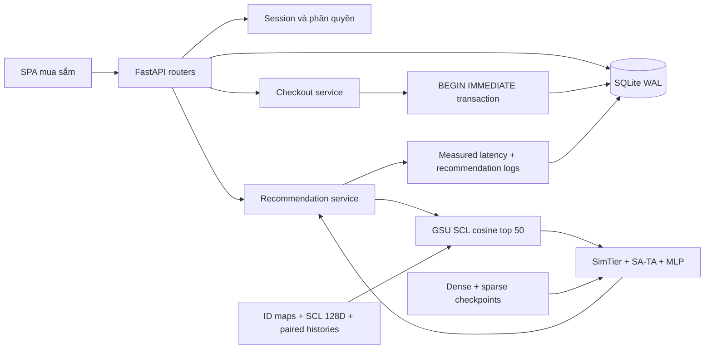

# Kiến trúc và phân tích triển khai

Ứng dụng phục vụ hai mục đích: luồng mua sắm của khách hàng và kiểm chứng suy luận MUSE. Mã nguồn giữ cấu trúc FastAPI → routers → services / recommender → SQLite của dự án. Frontend SPA dùng HTML, CSS và JavaScript thuần, không cần Node, CDN Tailwind hoặc Alpine để chạy. Tài nguyên giao diện và ảnh đã cache được phục vụ từ `/static`.

## Luồng dữ liệu

## Nghiệp vụ đã triển khai

| Nhóm | Hành vi hiện tại |
|---|---|
| Tài khoản | Đăng nhập, đăng ký, đăng xuất, session cookie HttpOnly, cập nhật tên/điện thoại/giới tính/năm sinh/ảnh đại diện có sẵn, đổi mật khẩu |
| Khôi phục | OTP demo 888999, challenge theo tài khoản, hạn 5 phút, tối đa 5 lần thử, dùng một lần, thu hồi session sau reset |
| Khám phá | 8 ngành hàng, tìm kiếm không dấu theo từng từ, lọc giá/tỉnh, sắp xếp và phân trang, chi tiết, gian hàng theo từ khóa, yêu thích |
| Địa chỉ | Thêm/sửa/xóa, kiểm tra quyền sở hữu, một địa chỉ mặc định, danh sách 34 tỉnh/thành |
| Giỏ hàng | Tăng/giảm/xóa, chọn sản phẩm để thanh toán, nhóm shop, kiểm tra tồn kho |
| Ưu đãi | Lưu voucher, hạn dùng, đơn tối thiểu, trần giảm, voucher đơn đầu/thành viên, một lượt sử dụng, Xu tối đa 25.000 mỗi đơn |
| Đặt hàng | Báo giá server, cước theo tỉnh/số shop, COD/ví demo, idempotency, trừ kho/Xu/ví/voucher nguyên tử, lưu snapshot tên/ảnh/giá/shop |
| Sau mua | Tab trạng thái, hủy đơn chờ xác nhận, hoàn tồn kho/tiền/Xu/voucher đúng một lần, mua lại, đánh giá sau nhận hàng |
| Thông báo | Đặt/hủy/chuyển trạng thái, ưu đãi dựa trên lượt xem, đánh dấu đã đọc; không có dịch vụ push ngoài web |
| MUSE | Ranking trang chủ theo checkpoint, tương đồng SCL tại chi tiết, lựa chọn mua kèm theo giá và ranking trong giỏ, ghi nhận click/add/purchase |
| Thuyết trình | 8 hồ sơ demo, MUSE Lab, raw ID dưới dạng chuỗi 64-bit, lịch sử 1K, điểm click/cosine, coverage, độ trễ và nguồn mô hình |

Mã tỉnh được giữ là khóa nội bộ của database, không phải mã hành chính quốc gia. Dữ liệu cũ giữ Bình Dương ở id 34 được chuyển sang Hưng Yên; tham chiếu địa chỉ/kho Bình Dương trước đó được chuyển sang TP.HCM. Phí ship là biểu phí demo, không phải báo giá của hãng vận chuyển.

## Giao dịch và bảo mật

- `BEGIN IMMEDIATE` nối việc tính lại báo giá, kiểm kho, trừ ví/Xu, dùng voucher, ghi đơn, ghi hành vi và xóa món đã mua trong một transaction. Nếu bước nào lỗi, toàn bộ thay đổi rollback.
- `(user_id,idempotency_key)` là unique index. Request cùng key và nội dung trả đơn cũ; key đã dùng với nội dung khác trả 409. Kiểm tra tồn kho bằng điều kiện trong câu UPDATE để tránh bán vượt kho. Frontend gửi tổng tiền đã xem; nếu tổng tiền server tính lại khác, trả 409 trước khi trừ ví để khách kiểm tra lại.
- Hủy đơn chỉ thực hiện từ trạng thái chờ xác nhận và có tính idempotent. Đơn lưu snapshot thông tin mua hàng.
- PBKDF2-HMAC-SHA256 với salt ngẫu nhiên và 600.000 vòng. SHA-256 cũ chỉ được đọc tương thích và nâng cấp khi đăng nhập thành công. Theo [OWASP Password Storage](https://cheatsheetseries.owasp.org/cheatsheets/Password_Storage_Cheat_Sheet.html), SHA-256 đơn thuần không phải hàm lưu mật khẩu phù hợp.
- Token phiên ngẫu nhiên; database chỉ lưu SHA-256 của token. Cookie HttpOnly/SameSite=Strict; bật Secure qua môi trường. Chặn Origin khác host và Sec-Fetch-Site cross-site cho thao tác ghi. Không mở CORS.
- Truy vấn dùng tham số bind; route giỏ hàng/địa chỉ/đơn/thông báo giới hạn theo user từ session. Raw user ID không dùng làm thông tin xác thực.
- Có rate limit theo IP cho đăng nhập, đăng ký và OTP; không tin X-Forwarded-For trực tiếp. Khi vận hành sau reverse proxy cần cấu hình trusted proxy rõ ràng.
- Script khởi tạo có tính idempotent, không DROP bảng, không reset dữ liệu mua hàng. Repair danh mục giữ backup metadata trước thay đổi.

## Giới hạn khoa học phải trình bày đúng

1. Nạp đúng hai checkpoint; `load_state_dict(strict=True)` cho dense, đối chiếu kích thước vocab sparse với ID maps. Bảng nặng được memory-map, chỉ cache SCL của tập demo.
2. Tái sử dụng forward upstream ở commit `85eea1587164cd24eb6223d3d0243aca955af980`, giữ đúng Dice ở output và cách upstream truyền cosine recent sequence vào SA-TA. Không tự sửa kiến trúc đã huấn luyện. Mã phái sinh kèm Apache-2.0 và NOTICE trong `app/recommender/upstream`.
3. Đọc feature user và cặp item/category history từ test shard; feature target item từ Parquet. Click trên web thêm raw item/category thật tương ứng và suy luận lại trên tối đa 1.000 hành vi gần nhất. Không train lại online.
4. GSU tìm top-50 **hành vi trong lịch sử cho mỗi target**, không phải lấy ngẫu nhiên 50 sản phẩm. Trang chủ hiện chấm toàn bộ 1.000 ứng viên trong danh mục để có tính kiểm chứng.
5. 1.000 raw item ID có thật. Tên/giá/ngành hàng tiếng Việt, ảnh Unsplash, rating, lượng bán và tồn kho là dữ liệu thương mại minh họa. Không có bộ ảnh Taobao gốc; URL `sig=...` không biến một ảnh thành ảnh độc lập. Không tuyên bố 1.000 ảnh độc nhất.
6. Vì metadata thương mại là minh họa, không thể kết luận ranking checkpoint theo raw ID/SCL gốc phản ánh chính xác các tên tiếng Việt đang hiển thị. Cần bộ mapping hàng hóa thực và tái huấn luyện/đánh giá khi dùng cho khách thật.
7. `inference_ms` đo preprocessing/GSU/ranking; `latency_ms` đo truy vấn ứng viên và phần xử lý dịch vụ đến khi tạo metadata, chưa gồm ghi log, HTTP và render. `Server-Timing` đo middleware HTTP. Không đặt số 4 ms cố định. Lượt đầu có thời gian warm-up.
8. GAUC/AUC/loss trong Lab là số từ báo cáo người dùng cung cấp. Ứng dụng chưa chạy lại evaluation; không suy ra hết overfitting chỉ từ hai loss gần nhau. Điểm thay đổi sau click không đảm bảo danh sách top thay đổi lớn.
9. Khi thiếu checkpoint/maps/features, web có fallback theo phổ biến, không sinh `P(click)` giả. Guest dùng phổ biến. Tài khoản mới dùng embedding OOV và lịch sử tương tác mới, được đánh dấu cold start.
10. API tương đồng hiển thị cosine, không gắn nhãn xác suất click. Đề xuất mua kèm không bịa mặt hàng 30–60k nếu danh mục chưa có giá đó.

Nguồn: [MUSE chính thức](https://github.com/alimama-tech/MUSE), [bài báo](https://arxiv.org/abs/2512.07216), [34 đơn vị hành chính trên Cổng Chính phủ](https://xaydungchinhsach.chinhphu.vn/chi-tiet-34-don-vi-hanh-chinh-cap-tinh-tu-12-6-2025-119250612141845533.htm).

## Đưa vào vận hành khách hàng thật

Đây là nền tảng demo full-stack đã có kiểm thử nghiệp vụ, chưa phải một sàn thương mại điện tử đã nghiệm thu production. Để vận hành thật cần hoàn tất:

| Phạm vi | Tích hợp/điều kiện còn cần |
|---|---|
| Thanh toán | Nhà cung cấp được cấp phép, callback/webhook có chữ ký, đối soát, hoàn tiền, trạng thái thanh toán riêng; tuyệt đối không dùng số dư demo làm tiền thật |
| Vận chuyển | Báo phí và tạo vận đơn qua hãng vận chuyển; webhook tracking, quy tắc vùng giao, xử lý thất bại giao hàng |
| Danh mục | Dữ liệu nhà bán có quyền sử dụng, ảnh sản phẩm thật, SKU/biến thể/bảo hành, định giá và tồn kho thực; mapping feature đúng với model |
| Tài khoản | Email/SMS OTP thật, xác minh liên hệ, quy trình hỗ trợ, chuẩn chính sách mật khẩu và thu hồi phiên theo yêu cầu vận hành |
| Nhà bán/vận hành | Phân quyền seller/admin, duyệt sản phẩm, xử lý trả hàng/hoàn tiền/tranh chấp, kiểm duyệt đánh giá, nhật ký quản trị |
| Hạ tầng | HTTPS/reverse proxy, backup và diễn tập restore; PostgreSQL/Redis và model service riêng khi có nhiều replica; queue/outbox cho webhook và thông báo |
| Quan sát | Metrics, cảnh báo, lỗi tập trung, retention nhật ký, load test theo QPS thực tế và SLO được đo |
| Mô hình | Tập validation đúng domain, đánh giá GAUC/NDCG/Recall/coverage, calibration, A/B test, model registry/rollback và drift monitoring |
| Vận hành doanh nghiệp | Điều khoản/dữ liệu cá nhân/đổi trả/hóa đơn và các yêu cầu của đơn vị kinh doanh được rà soát riêng trước khi ra mắt |

`DEMO_MODE=false` ẩn API đổi hồ sơ, debug, chuyển trạng thái demo; tắt OTP giả lập và ví mô phỏng. Trạng thái đơn không tự chuyển theo thời gian. Chế độ này chưa tự tích hợp các dịch vụ còn thiếu ở bảng trên.
